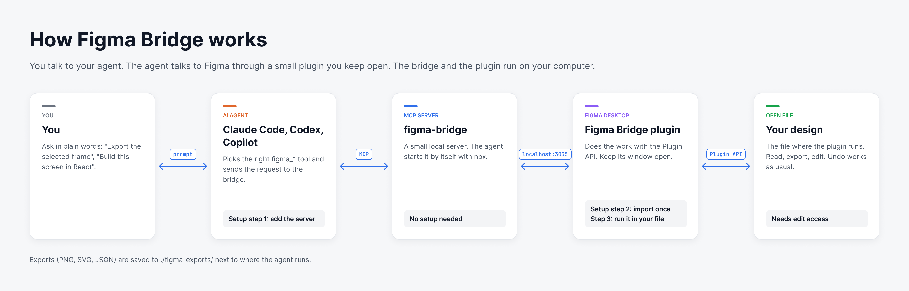
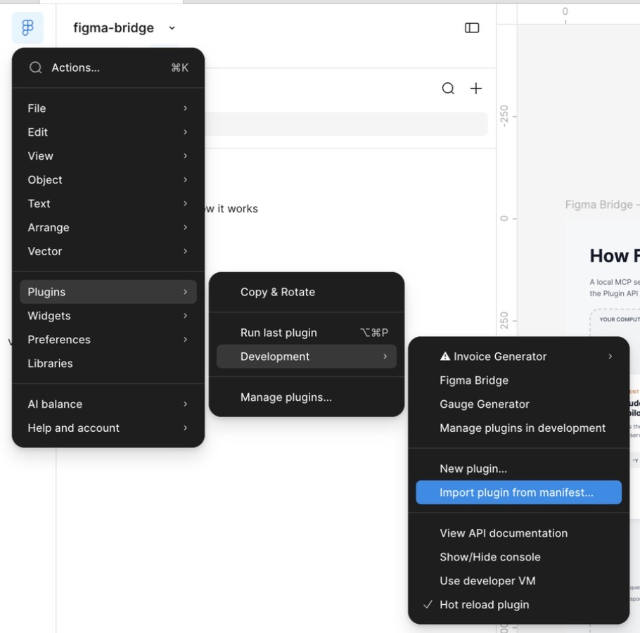
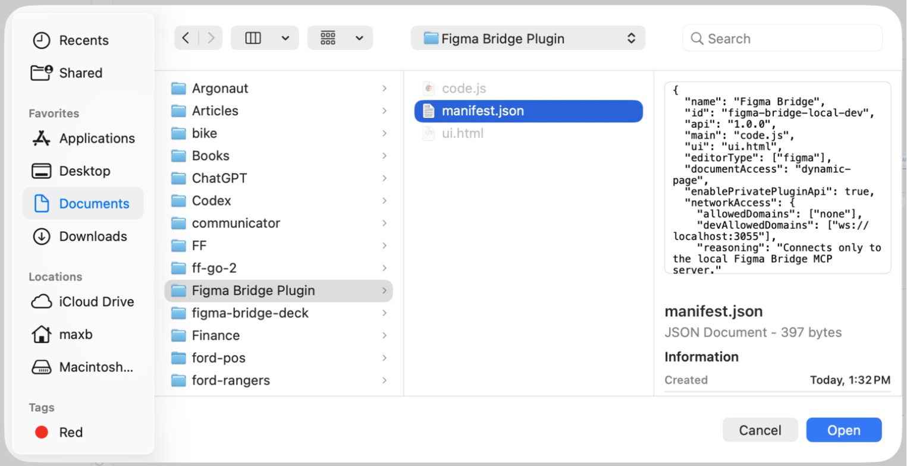
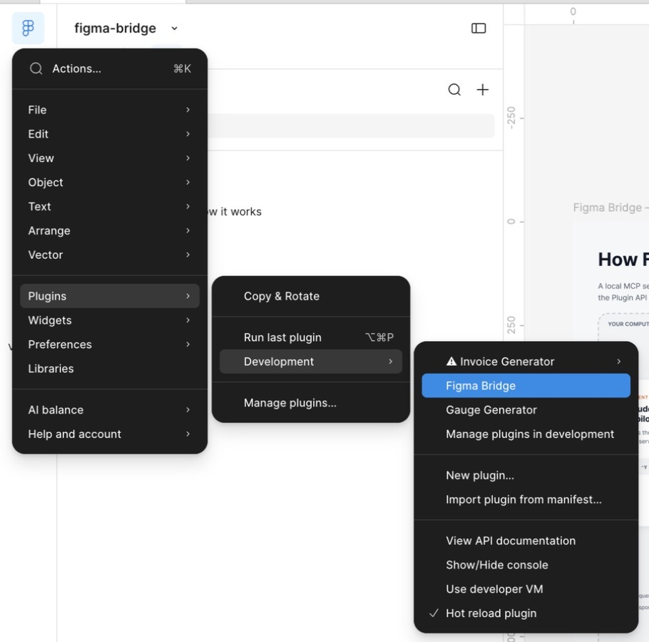
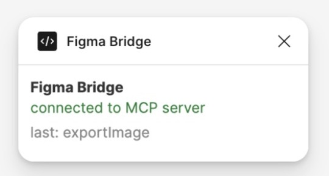

# Getting started

This guide gets your AI agent talking to Figma in about five minutes. You'll add a server
to your agent, import a plugin into Figma once, and run it in the file you want to work on.



You need:

- [Node.js](https://nodejs.org) 18 or newer (the LTS installer is fine)
- Figma Desktop. The browser version won't work.
- Edit access to the file. If you can only view it, duplicate it to your drafts.

## Step 1. Add the server to your agent

The simplest way is to ask your agent to do it. Paste this into Claude Code, Codex,
Copilot or any other agent that can run terminal commands:

> Set up Figma Bridge from https://github.com/MaxsBond/figma-bridge for me. Add the MCP
> server `npx -y @maxsbond/figma-bridge` to your own MCP config, then run
> `npx -y @maxsbond/figma-bridge setup` to copy the Figma plugin. Tell me if I need to
> restart you.

Restart the agent afterwards so it picks up the new server.

If you'd rather do it yourself, it's one command or one config entry:

| Agent | How |
|---|---|
| Claude Code | `claude mcp add --scope user figma-bridge -- npx -y @maxsbond/figma-bridge` |
| Codex | `codex mcp add figma-bridge -- npx -y @maxsbond/figma-bridge` |
| VS Code (Copilot) | Click [Install in VS Code](https://insiders.vscode.dev/redirect/mcp/install?name=figma-bridge&config=%7B%22command%22%3A%22npx%22%2C%22args%22%3A%5B%22-y%22%2C%22%40maxsbond%2Ffigma-bridge%22%5D%7D) |
| Others | See [the README](../README.md#use-with-claude) |

## Step 2. Import the plugin into Figma (once)

**Get the plugin files.** Skip this if your agent already ran it in step 1. Otherwise run
in a terminal:

```bash
npx -y @maxsbond/figma-bridge setup
```

It copies the plugin to `Documents/Figma Bridge Plugin` and opens that folder.

**Open the import dialog.** In Figma Desktop open any design file. Click the Figma logo in
the top-left corner and go to **Plugins → Development → Import plugin from manifest…**



**Pick `manifest.json`.** Go to `Documents/Figma Bridge Plugin`, select `manifest.json`
and click **Open**. Tip: press `⌘⇧G` in the dialog and paste
`~/Documents/Figma Bridge Plugin` to jump there.



That's it. "Figma Bridge" now shows up under Plugins → Development.

## Step 3. Run the plugin in your file

Do this every time you want the agent to work in Figma. Open the file and go to
**Plugins → Development → Figma Bridge**.



A small window opens. When your agent is running, it says **connected to MCP server**:



If it says "disconnected — retrying…", the agent isn't running yet. Start it, and the
plugin connects by itself within about 10 seconds.

Keep this window open while you work. Closing it stops the bridge. The agent only sees
the file where the plugin is running.

## Step 4. Talk to your agent

Start with a connection check:

> Check the Figma connection. What file is open and what's selected?

If the agent answers with your file name, everything works. Now ask for real work:

- "Export the selected frame as PNG and SVG."
- "Build this screen as a React component: <paste a Figma link to the frame>."
- "Pull the colors and text styles from this file into CSS variables."
- "Rename every layer called `Frame 12…` on this page to something meaningful."
- "Make a dark variant of the selected component set."

To point at a specific frame, select it in Figma or paste a Figma link to it. Exports are saved to `figma-exports/` in the folder where the
agent runs.

The agent can change your file. Figma's undo works as usual, but check what it does in
files that matter.

## If something doesn't work

| What you see | What to do |
|---|---|
| Agent says "Figma plugin is not connected" | Run Plugins → Development → Figma Bridge in the file you want to work on (step 3). |
| Agent has no `figma_*` tools | The server isn't added, or the agent wasn't restarted after step 1. |
| Plugin says "disconnected — retrying…" | Start or restart the agent. |
| "Port 3055 is already taken" | Two agents have Figma Bridge enabled at once. Close one of them. |
| Figma won't run the plugin | You only have view access. Duplicate the file to your drafts. |

More details are in [the README](../README.md#troubleshooting).
